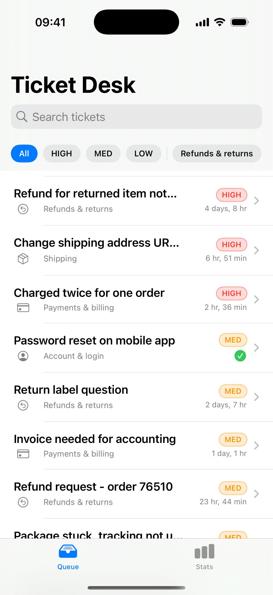
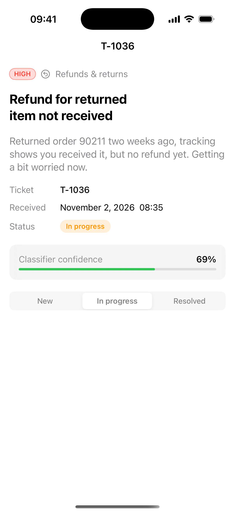
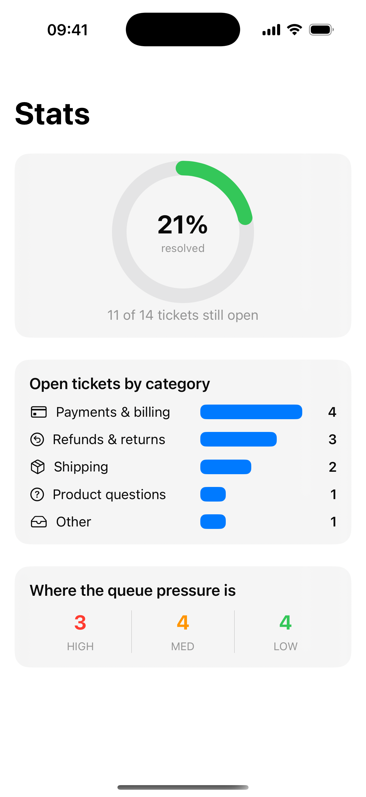

# Ticket Desk — iOS app (SwiftUI)

A compact support-ticket queue app for iOS, built in SwiftUI. It is the
mobile companion to the [AI Ticket Triage Pipeline](../ai-ticket-triage-pipeline)
project: the pipeline classifies tickets on a Mac, this app is what the
support team carries in their pocket.

Built by **Zeforge Studio**.

> **Need an iOS app built or fixed?** I develop and debug SwiftUI/UIKit
> apps — from small utilities to full App Store releases.
> **[Hire me on Fiverr →](https://www.fiverr.com/zefworks)**

## What it demonstrates

- **SwiftUI lists & navigation** — priority-sorted queue, filter chips
  (priority + category), search, detail push navigation
- **Local persistence** — every status change is written to a JSON file in
  the documents directory; no backend, works offline. Swapping in a REST
  API means replacing one `save()` call
- **Observable state** — `@Observable` store, filters as source of truth,
  derived `filtered` list
- **Honest AI UX** — the classifier confidence is shown per ticket, and
  low-confidence tickets are visually flagged for a human instead of being
  auto-answered
- **Stats screen** — resolution ring, category bars, queue-pressure split

## Screenshots

| Queue | Ticket detail | Stats |
|---|---|---|
|  |  |  |

Captured on the iOS Simulator (iPhone 16 Pro, iOS 18.1). The app supports
launch arguments for deterministic screenshots:

```
--screen=list | detail | stats
```

## Build & run

Open `TicketDesk.xcodeproj` in Xcode 16+, pick any iOS 17+ simulator,
Run. No third-party dependencies, no signing team needed for simulator.

Deployment target: iOS 17.0 (uses `@Observable`). Swift 5.

---

Have an existing app that crashes, needs a feature, or must pass App Review?
**[Message me on Fiverr](https://www.fiverr.com/zefworks)** — async,
text-only, written updates at every step.
